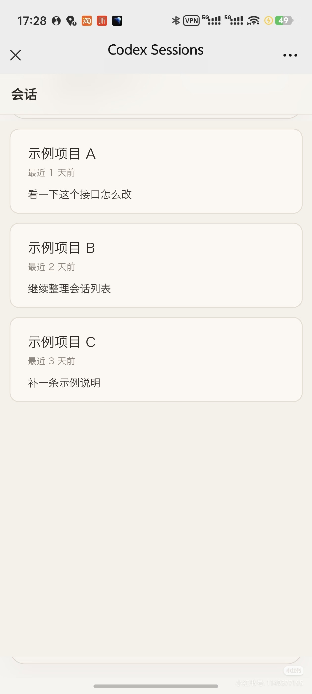
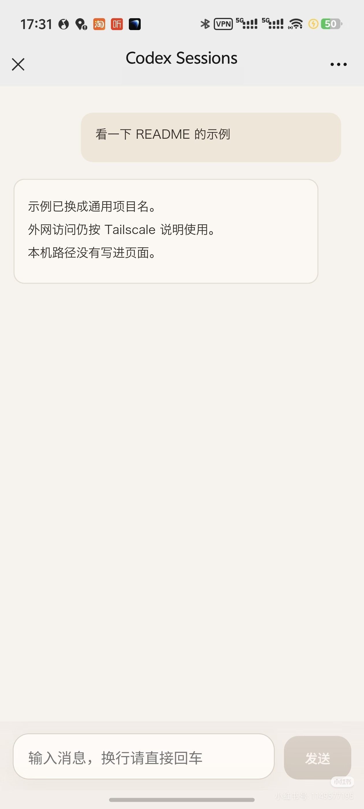

# 代码网页终端

[英文](./README.md) | 简体中文

只做一件事：把你电脑上的代码助手会话放到浏览器（含手机）里用。

主聊天界面面向这套代码助手，并保留旧终端通道的兼容能力。

## 示例截图

<p align="center">
  
  
</p>

## 前置依赖

- 运行环境 22.15 或更高版本
- 已安装 `codex` 命令，并可在终端直接运行
- 如果要外网访问：电脑和手机都要安装 `Tailscale`，并登录同一账号

## 1 分钟本地跑起来

```bash
git clone https://github.com/SZZH/codex-cc-web-terminal.git
cd codex-cc-web-terminal
npm run setup
```

`npm run setup` 会逐步引导你完成环境文件、可选的远程组网、依赖安装和服务启动。

视窗系统以外可以手动执行：

```bash
cd codex-cc-web-terminal
cp .env.example .env
# 把 .env 里的 ACCESS_TOKEN 改成你自己的；默认的 change-me 会被拒绝
npm install
npm run dev:up
```

在视窗系统的命令行里改用：

```bash
npm install
npm run dev
```

打开：

- 前端（推荐）：`http://127.0.0.1:5173/#/sessions`
- 后端直连：`http://127.0.0.1:3210`（如果改过 `PORT`，这里用对应端口）

## 手机访问（两种）

### 甲、同一无线局域网

1. 在 `.env` 中确认 `HOST=0.0.0.0`
2. 手机打开：`http://你的电脑局域网地址:3210`
3. 用 `ACCESS_TOKEN` 登录

### 乙、远程组网（外网推荐）

这条路径的前提：电脑和手机都安装 `Tailscale`，并登录同一账号。

1. 电脑安装并登录[官方下载页](https://tailscale.com/download)
2. 安卓或苹果手机安装同一应用，并登录同一账号
3. 电脑执行：

```bash
tailscale status
tailscale ip -4
```

4. 手机打开：`http://电脑的100.x.x.x:3210`

建议在 `.env` 中打开：

```env
TAILSCALE_ONLY=true
```

## 部署

```bash
npm run service:start
npm run service:status
npm run service:logs
```

官方应用服务会明确接收当前线程的模型、推理强度和权限设置。网页目前会拒绝需要审批的命令、文件修改和权限提升，不会自动同意。输入设置支持只读、自动审核和完全访问。自动审核由代码助手自己的审核过程处理，网页不会替用户同意尚未支持的人工审批。模型、思考强度和权限只保存在当前线程，不修改桌面端的全局权限。思考档位跟随所选模型的能力，发送前会等待设置保存完成。第二版主聊天通过官方应用服务发送。

侧栏按本机代码助手的项目身份、成员、置顶和排序展示，直接读取桌面端的项目信息，避免每次都遍历全部对话文件。模型选项来自当前官方应用服务的实际模型目录。

会话列表可以在“分组”和“最近活动”之间切换。每组默认显示 5 条，可以展开全部。最近活动按实际使用时间，跨项目排序。列表和分组标题会标出已经确认正在运行的会话。桌面端独占的线程如果没有可靠的运行证据，就保持未知，不会把尚未加载或已经中断的记录误报成正在运行或已经结束。无法可靠换算成三档权限的自定义策略，必须先明确选择权限，才能继续聊。

## 代码助手聊天（第二版）

聊天使用官方的线程、轮次和条目身份，历史分页有上限，并通过稳定的线程编号订阅长连接。当前能看到的历史页会自动补齐中间的消息、文件和过程条目，最多同时补两轮。已经完成的旧轮直接复用，最新一轮只读取上次之后的新条目。执行过程默认折叠。断线后只恢复历史和订阅，不会把原来的提示再发一遍。旧的文件历史在读取时转换，旧终端通道仍然单独保留。

每次提交都有可以保留的请求回执。默认排队发送，等网页自己持有的当前轮结束。“立即引导”给这一轮补充输入，“停止”明确中断这一轮。等待发送的消息显示在输入框上方，可以逐条改成引导，不会重复提交。展开过程时会自动补读详情。没有可见内容的思考条目不占卡片。失败的消息保留原文和附件。发送结果暂时无法确认时会自动核对，不会盲目重发。

一条消息可以保留多行文字，最多附带 6 张常见静态图或动图，每张不超过 20 兆字节。本机图片和回复中的内嵌图片都通过登录后的媒体地址读取。工具输出和文件差异按需展开，超大内容会明确标出已截断。网页不会抢走桌面端正在持有的线程。遇到写入冲突时，消息进入官方桌面队列，保留原来的线程编号、原文和附件，再按官方历史确认是否已经执行。桌面会话尚未加载或已经中断时，队列可能暂时不会消费，页面应保持“待执行”，不能当成已经发送完成。只读查看不会取得执行权，网页也不能停止或引导桌面端持有的活动轮。

详细约定见[第二版聊天说明](./docs/refactoring/codex-chat-v2.md)和[桌面兼容边界](./docs/architecture/codex-desktop-compatibility.md)。

## 本地文件与网页预览

聊天里的本地文件链接，以及已经在本机回环地址上打开的网页，可以在电脑侧边或手机全屏中打开，聊天位置和草稿都还在。文件预览使用 `kkFileView` 5.0.3，主要覆盖办公文档、图片、便携文档和标记文本。电脑和相关服务需要保持在线。预览使用单独端口，以及有时限、有范围的访问授权。私人目录不能当成公开的静态内容放出去。

可选的内网穿透、站点配置、原生运行时和兼容边界，见[本地预览运维说明](./docs/operations/local-preview.md)。

## 最常用命令

```bash
npm run dev            # 跨平台开发模式（前后端前台运行）
npm run dev:up         # 仅视窗系统以外：后台启动开发服务
npm run dev:down       # 仅视窗系统以外：停止后台开发进程
npm run check          # 快速自检
```

## 三个高频问题

1. `Cross-origin request rejected`
- 优先用 `npm run dev` 启动。苹果系统和 Linux 也可以用 `npm run dev:up`。不要把前后端拆开手动启动。

2. `5173` 打不开
- 先执行 `npm run dev`，再查看端口：
```bash
# 视窗系统以外
lsof -iTCP:5173 -sTCP:LISTEN -n -P

# 视窗系统
netstat -ano | findstr :5173
```

3. 手机提示“电脑未连接”
- 先确认电脑上的服务在线：`npm run service:status`
- 再确认网络路径：同一无线局域网，或同一个远程组网
- 如果改过 `PORT`，手机访问地址也要用同一个端口。

## 更新日志

### `v0.4.6`

- 提问提醒跟随桌面当前轮次同步：完成、停止或切入新一轮后收起旧问题浮窗，历史题目保留只读，手机输入区自动恢复且不清空草稿。
- 正确识别桌面已接受的引导回答和单对象回答封装，保留未确认回执与断线核对提示。

### `v0.4.5`

- 手机展开提问时优先展示回答区，精简重复标题与留白，只保留一层正文滚动；返回聊天恢复普通输入区，草稿和排队消息保持不变。
- 长问题的提交操作保持可见，紧凑模式继续显示提交中、待核对和失效状态。

### `v0.4.4`

- 官方历史确认后续轮次已开始时，解除缺少最终回执的旧请求对队列的阻塞，不重复发送旧消息，也不将旧结果误标为成功。
- 修复未加载的旧回执让已结束任务仍显示停止按钮的问题，刷新与重启后仍保持正确状态。
- WebSocket 保持连接时也会核对最新轮次状态，引导能力暂不可用时独立重试恢复。

### `v0.4.3`

- 支持在手机上直接引导已确认进入桌面队列的消息，明确提示暂不可用原因，确定发送失败后保留原文和附件。
- 引导结果不明确时保留回执供核对，网络超时或服务重启后不会自动重发。
- 将待处理的 Codex 提问和审批固定展示在输入框上方，新问题自动展开，收起后保留提醒与回答草稿。
- 已加载但位于历史显示窗口之外的问题仍可直接回答，只有确认官方回答后才移除提醒。

### `v0.4.2`

- 修复打开会话时旧回执和稀疏摘要提前显示的问题，保留加载状态和失败重试入口。
- 向前翻阅历史每页最多加载 90 项，每批最多补充 3 个更早轮次；内容请求最多并发 2 个，失败后只重试未成功的读取。
- 补历史时保留已显示的实时消息，避免短摘要覆盖完整正文，并在任务完成后补齐最终详情。
- 过滤本地文件页面的完整浏览器上下文包装，仅调整用户消息展示，保留原始记录。

### `v0.4.1`

- 新增贴合暖色界面的像素角色、标志和浏览器图标，统一加载、空态、错误和等待反馈。
- 优化会话列表与聊天标题、项目选择和手机点击区域；同目录的独立项目可以明确区分。
- 新增覆盖完整分页目录的运行中会话筛选，可与搜索组合使用。
- 输入后续消息时仍保留停止入口，并补充排队、引导和权限设置说明。

### `v0.4.0`

相较 `v0.3.0` 的核心更新：

- 聊天接入官方线程，支持排队发送、向当前轮补充输入，以及明确停止当前轮。
- 一条消息最多可以附带 6 张常见静态图或动图。发送失败会保留原文和附件。
- 网页不再抢占桌面端持有的线程。遇到写入冲突时，消息留在桌面队列中，并保持待执行。
- 新增本地文件和本机网页预览。电脑在侧边打开，手机全屏打开。
- 文件变更可以按轮次撤销和恢复。
- 会话列表按项目身份分页。
- 隐藏没有输出的成功命令日志，会话权限改为只读展示，并去掉点开会话时的蓝色高亮。

### `v0.3.0`

相较 `v0.2.0` 的核心更新：

- 会话列表只保留最近 7 天内使用过、且未归档的会话。没有会话的项目分组仍然保留。
- 调整手机端会话列表：去掉多余标题栏，分组入口改为加号，新建分组会话时显示加载状态。
- 当前轮还在进行时，输入区不再接受下一条，并暂时隐藏中断操作。
- 收紧线程输入、逐段增量消息和历史同步，发送后的会话状态保持一致。

### `v0.2.0`

相较 `v0.1.0` 的核心更新：

- 重构会话与线程主链路，统一为线程快照、标准事件和服务器推送。实时会话、历史会话和续聊的状态更加一致。
- 补齐历史会话的列表、消息渲染、历史图片恢复、线程续聊，以及消息展示的一致性。
- 新增文件变更面板，可以查看差异、把历史修改按轮次挂到对应位置，并撤销当前工作区的文件变更。
- 会话分组按最近使用时间排序，分组顺序随组内最新会话变化。
- 项目会话的筛选与代码助手对齐，按项目、当前分支和正常的桌面编辑器会话展示。
- 调整线程展示和过程区样式，统一执行过程与文件变更的折叠图标，并改进代码块和过程区的可读性。
- 补齐安装包中的服务脚本，统一启动、重启、状态检查和日志查看。
- 修复多项聊天体验问题，包括进入会话后不贴底、内容变化后滚动不稳定、历史消息归类错误、历史图片显示异常，以及历史内容里的控制指令泄漏到聊天气泡。

### `v0.1.0`

核心更新：

- 初始化仓库规则、协作说明和版本标签约定。

## 开源说明

- [许可证](./LICENSE)
- [贡献说明](./CONTRIBUTING.md)
- [安全策略](./SECURITY.md)
- [行为准则](./CODE_OF_CONDUCT.md)
